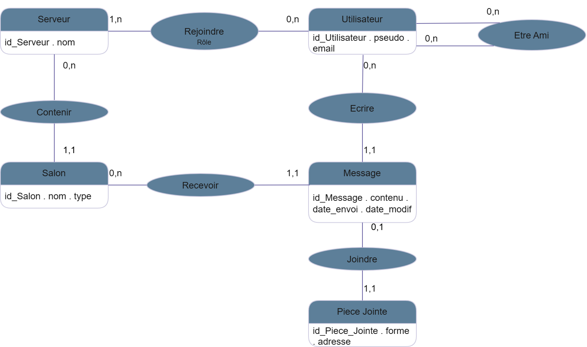

# 0 — Résumé

En raison de l'intérêt porté à Discord avec seulement quatre ingénieurs Back-end, tenir une base capable d'écrire et lire les messages (50/50) et rechercher d'anciens messages au hasard des utilisateurs devenait impossible (+120 millions de messages par jour). Ils ont utilisé MongoDB qui a cessé de fonctionner à partir de 100 millions de messages ; pour cause les données et l'index ne tenaient plus en mémoire vive, et le sharding n'était pas convaincant dû au risque possible.

Ils ont changé pour Cassandra, qui peut répartir automatiquement mais où tous les messages d'un salon allaient dans une même partition qui grossissait sans limite : au-delà de 100 Mo. Un autre problème : les tombstones qui encombraient les lectures, les pauses pour vider les déchets ainsi que les gros salons qui saturent les mêmes nœuds. Discord a fini par utiliser ScyllaDB, plus rapide et sans pause, avec des services en Rust qui regroupent les requêtes identiques avant qu'elles n'atteignent la base.

# 1 — Ce que le système doit garantir

## 1.a — Le Système, vu de l'extérieur

| Type | Terme | Cycle de vie | Réponse à l'ambiguïté |
|---|---|---|---|
| Objet | **Serveur** | Créé par un utilisateur, qui en devient propriétaire. Fin quand le serveur est supprimé, ou aucun membre | Un serveur est une communauté qui regroupe des membres et des salons. |
| Acteur | **Membre** | Quand un utilisateur rejoint un serveur. Fin par départ ou exclusion | Un membre est un utilisateur qui appartient à un serveur. Propriétaire et modérateur sont aussi des membres. |
| Objet | **Salon** | Créé dans un serveur, nom unique dans ce serveur. Fin : suppression du salon par modérateur, propriétaire | Un salon est un espace de discussion d'un serveur, textuel ou vocal selon le cas d'usage. |
| Objet | **Message** | Créé par un membre du serveur dans un salon textuel. Modifiable, avec date optionnelle. Fin : par l'utilisateur ou le modérateur ou le propriétaire | Un message est un objet complet : auteur, contenu, date d'envoi, éventuellement date de modification et pièce jointe. Les messages sont triés par date d'envoi |
| Acteur | **Ami** | Lien créé entre deux utilisateurs par invitation, symétrique, une seule fois par paire. Fin : par l'utilisateur | Un ami est un utilisateur lié à un autre par une amitié explicite, différent d'un simple membre du même serveur. |
| Objet | **Statut (ex : En ligne)** | État renouvelé à chaque interaction avec Discord | En ligne veut dire que la présence a été « renouvelée » il y a moins de 5 minutes, différent de présence ou connecté |
| Acteur | **Propriétaire** | Devient propriétaire en créant le serveur. Fin : quand le serveur n'existe plus | Un serveur a un propriétaire, c'est un rôle de l'appartenance et non un statut de l'utilisateur. |
| Acteur | **Modérateur** | Un membre reçoit ce rôle dans un serveur. Fin : suppression du rôle par le propriétaire | Un modérateur est un membre dont le rôle est intermédiaire entre propriétaire et membre. |
| Objet | **Tableau de bord** | Un par serveur, mise à jour quotidienne | Le tableau de bord est calculé par serveur : le nombre de messages et le nombre d'auteurs distincts par jour. Il n'est pas en temps réel. |
| Objet | **Pièce Jointe** | Elle est créée en même temps que le message, quand l'auteur l'envoie. Elle est facultative et il n'y en a qu'une par message. Elle n'existe jamais toute seule et disparaît avec son message. Fin : par l'utilisateur ou le modérateur ou le propriétaire | La pièce jointe est un élément transmis avec ou remplaçant le contenu du message (image, gif, document, lien) |

## 1.b — Règles de gestion

| Garantie par le modèle (clé, FK, unicité, CHECK) | Garantie seulement par du code ou un trigger | Hors modèle relationnel (autre paradigme probable) |
|---|---|---|
| Un utilisateur a un pseudo et un e-mail ; un e-mail identifie au plus un utilisateur. | Un serveur a toujours un propriétaire ; il est créé avec sa première appartenance au rôle propriétaire. Garant : transaction à la création du serveur, ou trigger. | Une présence expire d'elle-même 5 minutes après le dernier signe de vie. Paradigme : clé-valeur avec expiration (TTL). |
| Un serveur compte au plus un membre au rôle propriétaire. | Un salon vocal ne reçoit aucun message ; un message n'existe que dans un salon textuel. Garant : trigger sur les messages. | Une pièce jointe est une image, un fichier ou un lien, chacun avec ses propres attributs. Paradigme : document (JSON). |
| Une appartenance a un rôle entre propriétaire, modérateur et membre : un utilisateur a un seul rôle par serveur. | Un utilisateur écrit dans un salon seulement s'il est membre du serveur de ce salon. Garant : contrôle dans le service d'écriture, ou trigger. | |
| Un utilisateur écrit plusieurs messages, un message a un seul auteur et appartient à un seul salon. | Le tableau de bord d'un serveur est recalculé chaque jour (messages et auteurs distincts). Garant : traitement planifié chaque nuit. | |
| Un message a un contenu et une date d'envoi et une date de modification si modifié sinon elle sera égale à la date d'envoi | | |
| Un message a au plus une pièce jointe ; une pièce jointe appartient à un seul message. | | |
| Une amitié relie deux utilisateurs différents | | |

## 1.c — MCD

## 1.d — MLD et MPD

Clé primaire en **gras** et `#` = clé étrangère :

- UTILISATEUR (**id_utilisateur**, pseudo, email)
- SERVEUR (**id_serveur**, nom)
- REJOINDRE (**#id_utilisateur, #id_serveur**, role)
- AMITIE (**#id_utilisateur_1, #id_utilisateur_2**)
- SALON (**id_salon**, nom, type, #id_serveur)
- MESSAGE (**id_message**, contenu, date_envoi, date_modif, #id_salon, #id_auteur)
- PIECE_JOINTE (**id_piece_jointe**, forme, adresse, #id_message)

| Au MCD | Au MLD | TP |
|---|---|---|
| Contenir : SALON (1,1) — SERVEUR (0,n) | clé étrangère côté (1,1) | `salon.id_serveur` |
| Recevoir : MESSAGE (1,1) — SALON (0,n) | clé étrangère côté (1,1) | `message.id_salon` |
| Écrire : MESSAGE (1,1) — UTILISATEUR (0,n) | clé étrangère côté (1,1) | `message.id_auteur` |
| Joindre : PIÈCE JOINTE (1,1) — MESSAGE (0,1) | clé étrangère UNIQUE, ou fusion | `piece_jointe.id_message` (UNIQUE) |
| Rejoindre : UTILISATEUR (0,n) — SERVEUR (1,n) | table de liaison, clé composée | `rejoindre(id_utilisateur, id_serveur)` + `role` |
| Être ami : UTILISATEUR (0,n) — UTILISATEUR (0,n) | table de liaison, clé composée (réflexive) | `amitie(id_utilisateur_1, id_utilisateur_2)` |
| association avec identité | entité à part entière | MESSAGE, pas « écrire » |

## 1.e — Questions au client

1. Les trois rôles (propriétaire, modérateur, membre) sont-ils figés, ou les serveurs pourront-ils créer leurs propres rôles avec des permissions ?
2. Que deviennent les messages d'un utilisateur qui quitte un serveur, en est exclu, ou supprime son compte ?
3. Un message peut-il porter plusieurs pièces jointes ?
4. Certains salons seront-ils réservés à une partie des membres du serveur (salons privés, salon réservé aux modérateurs) ?
5. Les utilisateurs pourront-ils s'envoyer des messages privés, en dehors de tout serveur ?
